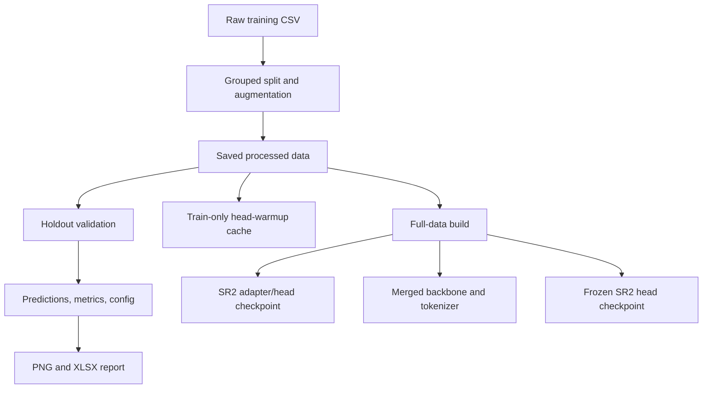

# Codebase reference

Use this map to find ownership before changing implementation. Keep user
interaction in CLI modules, orchestration in pipelines, and domain behavior in
focused classes. Prefer package public exports to private cross-package helpers.

## Documentation boundaries

| Document | Owns |
| --- | --- |
| [README.md](README.md) | Overview, active profiles, and navigation |
| [docs/getting-started.md](docs/getting-started.md), [docs/colab.md](docs/colab.md), [docs/kaggle-submission.md](docs/kaggle-submission.md) | Local/remote setup, operational workflows, and the Kaggle submission notebook |
| [docs/commands.md](docs/commands.md), [docs/configuration.md](docs/configuration.md) | CLI behavior, field definitions, defaults, path rules, and batch experiments |
| [docs/data-preparation.md](docs/data-preparation.md), [docs/models.md](docs/models.md), [docs/lora.md](docs/lora.md) | Data/model behavior and training algorithms |
| [docs/caching.md](docs/caching.md), [docs/reports.md](docs/reports.md) | Cache identities/APIs, artifacts, reporting, and measurements |
| [docs/troubleshooting.md](docs/troubleshooting.md), [docs/migration.md](docs/migration.md) | Failure diagnosis and historical formats |
| This file | Runtime flow, module responsibilities, artifact map, and implementation invariants |

Keep detailed behavior in its owning guide and link to it here. Preset parameter
values belong in YAML; parser defaults belong in the configuration reference.
Update this map when ownership or runtime flow changes. Preserve historical run
snapshots when updating current documentation or presets.

## Runtime flow

The saved split included in Git can enter this flow without downloading raw data.
Standalone warmup is optional; inline LoRA runs create/reuse their compatible
warmup state. Validation does not save production checkpoints. Builds use IDs
from both partitions. Frozen SR2 saves only its independent head; LoRA builds
also export the merged backbone with its tokenizer.

Paths and `.env` resolve from the process working directory. The batch scripts
instead derive the project root from their own files and launch children there.
See [path resolution](docs/configuration.md#configuration-files-and-paths).

## Entry points

Console scripts are declared in [pyproject.toml](pyproject.toml).

| Command | Module under `src/llm_classification_finetuning/` | Responsibility |
| --- | --- | --- |
| `init` | `cli.py` | Download missing `train.csv`, then preprocess |
| `data` | `data/cli.py` | Download missing `train.csv` only |
| `preprocess` | `preprocess/cli.py` | Rebuild the processed holdout |
| `model` | `models/cli.py` | Parse selection/mode, run profiles, report independent training/validation and global GPU peaks for validation/build/warmup, and print summaries |
| `result` | `result/cli.py` | Select a validation run and synthesize reports |

CLI modules translate expected `DataPreparationError` subclasses to exit status
`1`; parser errors retain argparse behavior. `models/cli.py` owns `ALL` iteration
and the build-only `warmup` selector outside the registry. Unsupported warmup
flags are rejected before data/GPU setup. Checkpoint tags require `--build`.
Business logic stays below this layer.

[scripts/validate.py](scripts/validate.py) runs batch holdout validation;
[scripts/build.py](scripts/build.py) runs full-data builds and standalone warmup.
Both own independent explicit model/config selection, sequential subprocesses,
terminal/log streaming, and failure summaries. Usage belongs in
[batch validation](docs/commands.md#batch-validation) and
[batch builds](docs/commands.md#batch-builds).
Validation additionally loads each selected config from the project-root cwd
and ensures its processed data before launching the model child, optionally
filling missing components from a project mirror via `--data-source-root`.
Successful data preparations are shared by resolved path within the batch;
preparation failures use the existing task log and failure summary.

The ignored local `!validate.ipynb` and `!build.ipynb` provide Colab setup and
their corresponding batch workflows. The build notebook additionally copies
current SR2 outputs to timestamped Drive backups before runtime release,
retaining the runtime if copying fails. Their behavior belongs in
[Colab](docs/colab.md#local-notebook-behavior).
The validation notebook passes its configurable `DRIVE_DATA_ROOT` project mirror
to the batch script; complete local processed data bypasses that source.

[submit.ipynb](submit.ipynb) is the tracked, self-contained Kaggle inference notebook (GPU
T4 x2, Python 3.13+, offline inference after upload-time dependency setup). It sits
outside the package and the `model` CLI: it reads the build's
`adapter.pt` head and `merged/` backbone and writes `submission.csv`. It duplicates the
SR2 v5 head and the conversation serializer, so changes to
`models/SR2_Qwen3_4B_lora/heads.py` or `models/common/data.py` must be mirrored there.
Behavior belongs in [Kaggle submission](docs/kaggle-submission.md).

## Package map

Paths below are relative to `src/llm_classification_finetuning/`.
Package `__init__.py` files expose intended public interfaces unless noted.

### Application and data preparation

| Module | Owns |
| --- | --- |
| `__init__.py` | Working-directory `.env` loading before library imports; PyTorch allocator and HF endpoint/Xet defaults without overriding explicit environment settings |
| `config.py` | Immutable config objects, strict YAML validation, data/cache/result path resolution (including shared `resolve_result_dir`), and effective shared warmup settings |
| `model_storage.py` | Native Hub cache routing through `load_pretrained`, offline local-only loading and actionable missing-file errors; timed backbone loading with scoped load-report suppression and restoration of progress-bar settings |
| `cli_config.py` | Shared `--config` argument |
| `cli_output.py` | Shared download/split summaries |
| `errors.py` | Expected domain-error hierarchy |
| `timing.py` | Unbounded `HH:MM:SS` duration formatting with optional millisecond precision for fast validation logs |
| `pipeline.py` | `PrepareDataPipeline`: download/preprocessing orchestration and optional download-progress callback; `EnsureProcessedDataPipeline`: local processed-data checks and optional project-mirror restoration without preprocessing |
| `data/downloader.py` | Missing Kaggle training CSV download and single-file ZIP normalization |
| `preprocess/splits.py` | Exact-response tie correction before labels/prompt hashes, grouped class quotas, balance orchestration, integrity summaries, and processed publication |
| `preprocess/token_balance.py` | Canonical token counting and deterministic equal-class whole-group exchanges |
| `preprocess/augmentation.py` | One swapped counterpart per original row |

### Profile registration and warmup

| Module | Owns |
| --- | --- |
| `models/__init__.py` | `ModelRegistration` and lazily loaded ordered active execution registry, keeping CPU data imports independent of PEFT |
| `models/profile.py` | Immutable selector/config/artifact identity and effective A/B policy |
| `models/SR2_Qwen3_4B/__init__.py`, `profile.py` | Frozen SR2 registration and lazy pipeline export |
| `models/SR2_Qwen3_4B/pipeline.py` | Independent frozen-head plateau-scheduled early-stopping validation and exponential fixed-epoch build orchestration, mode-specific warmup-compatible settings, `build_epochs` validation before CPU preparation, and head write preflight before GPU setup |
| `models/SR2_Qwen3_4B/checkpoint.py` | FP32 head-only checkpoint with immutable encoding/training identities, destination preflight, staged CPU metadata/tensor validation, and atomic replacement |
| `models/SR2_Qwen3_4B_lora/__init__.py` | Active SR2 registration surface and public LoRA exports, deferring pipeline/trainer imports until execution |
| `models/SR2_Qwen3_4B_lora/profile.py` | SR2 identity usable below the registration surface without import cycles; default for LoRA Python APIs |
| `models/warmup.py` | Standalone SR2 head warmup trained on the train partition, with current train/validation evaluation on builds and cache hits; shares SR2's cache namespace without adapters, joint plans, or production checkpoint |

Frozen SR2 and LoRA SR2 are registered in that order. `ALL` runs each configured
profile supporting the requested mode; `warmup` stays outside the registry.
Frozen SR2 has an independent `SR2ModelConfig` converted to shared head-training
settings. Validation uses unbounded head training with ReduceLROnPlateau, independent
early stopping, and shared frozen features. Builds and standalone/inline warmup
share endpoint-based exponential decay from the initial rate to `build_min_lr`
over `build_epochs`. Decaying head states use a versioned schedule identity;
fixed-rate cache identities remain compatible.
Retired profiles remain unregistered and
their configuration sections are rejected; local ignored
archives are outside active imports. See [migration](docs/migration.md#retired-profiles).

### Shared and frozen-model infrastructure

Paths in this table are under `models/common/`.
Legacy frozen-model modules remain as retained infrastructure and shared dependencies.
The active frozen SR2 profile uses the adapter-free path in the SR2 LoRA package,
with the current SR2 head and warmup feature identities, rather than legacy MLP training.

| Module | Owns |
| --- | --- |
| `contracts.py` | Execution modes, pipeline interface, and validation/build/warmup result summaries, including optional executed warmup/joint epoch counts and merged-backbone path for builds |
| `inputs.py` | Processed table loading, strict split/orientation/ID validation, multipart reads, and reconstructed source fingerprints |
| `data.py` | Tokenizer-injected official chat-template serialization and pairwise training repository |
| `hardware.py` | CUDA/precision validation, single-GPU placement, isolated phase intervals with cross-epoch allocator maxima, and reset-safe global peaks |
| `backbone.py` | Local weight/configuration content fingerprints for caches |
| `compatibility.py` | Frozen embedding and head-checkpoint compatibility construction |
| `cache_storage.py` | Locked file sessions, atomic/multipart publication, checksums, corruption archives, non-destructive component/size checks, and staged missing-component copies preserving authoritative manifests |
| `token_cache.py` | Content-addressed text encodings, compact CPU views, canonical pair tokens, and context validation |
| `cache.py` | Per-branch SQLite frozen/warmup embeddings, lossless FP16/BF16/FP32 storage, and rebinding to current rows |
| `extraction_batching.py` | Deterministic branch extraction plans comparing contiguous DP with best-fit by batch count, then padded tokens; stable length/iteration behavior |
| `extractor.py` | CPU identity preparation and lazy GPU encoding of missing frozen branches |
| `model.py` | Frozen backbone, last-real-token pooling, and `3H` pairwise MLP |
| `orientation.py` | A/B probability averaging and validation-row alignment |
| `loss.py` | Label smoothing on logits or averaged log probabilities; training reductions |
| `trainer.py` | Legacy holdout/full-data frozen-head training, shared epoch/final cached-head evaluation summaries, and optional training/validation memory intervals |
| `checkpoint.py` | Atomic legacy frozen head persistence and compatibility metadata |
| `progress.py` | CPU work counters, independent stage timers/completion, configurable percentage or timed updates, and optional silent completion for combined epoch summaries, retaining legacy weighted counters |
| `publishers.py` | Staged validation publication, effective YAML snapshots, and successful-run timing/peak updates |
| `pipeline.py` | Frozen validation/build orchestration |

### SR2 LoRA implementation

Paths in this table are under `models/SR2_Qwen3_4B_lora/`. SR2 owns the
implementation previously hosted by the retired EXPT2 profile; Python APIs
default to SR2. Retained legacy quantization/head branches are not active profiles.

| Module | Owns |
| --- | --- |
| `data.py` | Canonical token/feature views, branch flattening, independent right padding, and CPU pooling positions |
| `batching.py` | CPU loader preparation, shared tokens, global base plans, merged optimizer groups, epoch repacking, warmup training-ID/label identity context, and explicit frozen-head config/full-data preparation |
| `heads.py` | Head factory, precision wrapper, fused subtractive L/M win projections with absolute-difference and symmetric-product tie readouts, and retained legacy head definitions |
| `model.py` | Differentiable shared backbone/adapters, config-only head initialization with lazy frozen-backbone loading on feature misses and CPU/CUDA RNG preservation, direct device loading, pooling/dtypes, head calls, and per-joint-batch checkpointing |
| `extractor.py` | No-gradient CPU features for warmup or joint validation, optionally filling only missing branches into a shared tensor, with branch-batch progress callbacks |
| `trainer.py` | CPU token preparation, plateau-scheduled frozen-head validation, epoch-based exponential build/warmup and independent update-based cosine joint learning-rate curves, frozen-head validation early stopping with best-epoch predictions and per-epoch progress, both branch graphs and one backward pass, optimizer/scaler state, fixed-rate lower-epoch warmup continuation and shuffle replay, epoch-end warmup train/validation inference on shared features, independent extraction/warmup/joint progress and executed epoch counts, standalone cached-head evaluation, and optional training/validation memory intervals |
| `warmup_cache.py` | Completed head/AdamW/scaler/RNG identity, exact exponential-training or descending fixed-rate compatible-epoch lookup, distinct source/target paths, validation, atomic storage, and restoration |
| `warmup_feature_cache.py` | Adapter-free feature identity, complete-token branch lookup, missing-input deduplication/rebinding, and shared embedding-cache publication across frozen SR2 and standalone/inline warmup |
| `checkpoint.py` | Destination write preflight, portable adapter/head persistence and CPU readback validation, revision/architecture compatibility, and merged-backbone/tokenizer export with metadata, local validation, and recoverable directory replacement |
| `pipeline.py` | LoRA holdout orchestration and independent full-data build flow with CPU preparation and both write preflights before GPU setup, adapter/head saving before merged export, cleanup preserving execution errors |

### Reporting

| Module | Owns |
| --- | --- |
| `result/synthesizer.py` | Discovery, holdout CSV validation, A/B alignment, aggregation-marker reduction, and source-ID records |
| `result/writers.py` | Confusion-matrix PNG and filterable Excel workbook |
| `result/publisher.py` | Staging/promotion of both reports with backup/restore handling |

## Files and generated artifacts

Default paths assume the root preset and working directory. `RESULT_PATH`
defaults to `./results` and controls validation, report, and log roots.

| Path | Role |
| --- | --- |
| `config.yaml`, `configs/*.yaml` | Independent complete current presets |
| `config_archive/` | Historical configurations; not current defaults |
| `.env.example` | Kaggle token, model/training-cache/result paths, and offline HF execution template |
| `pyproject.toml`, `uv.lock`, `.python-version` | Package/entry points, training dependencies, and Python version |
| `<MODEL_PATH>/models--*/` | Native HF downloads; outside training-cache multipart storage |
| `data/raw/` | Downloaded `train.csv` |
| `data/processed/train_validation.parquet` | Logical saved split; single file or manifest plus volumes |
| `<CACHE_PATH>/token_cache/`, `embedding_cache/`, `adapter_batches/plans/` | Shared token, frozen/warmup-feature, and LoRA base-plan stores |
| `<CACHE_PATH>/SR2_Qwen3_4B_lora_warmup/` | Completed Skywork head state, shared by frozen SR2, LoRA SR2, and standalone warmup |
| `models/SR2_Qwen3_4B/head[_TAG].pt` | Independent frozen SR2 head and encoding/training metadata |
| `models/SR2_Qwen3_4B_lora/adapter[_TAG].pt` | SR2 production adapter/head |
| `models/SR2_Qwen3_4B_lora/merged[_TAG]/` | Full LoRA-merged backbone, tokenizer, and export metadata |
| `<RESULT_PATH>/MODEL-<timestamp>/` | Completed validation CSV, metrics, and YAML snapshot |
| `<RESULT_PATH>/comprehensive/` | Latest synthesized report pair |
| `<RESULT_PATH>/logs/validate-*.log` | Immediately flushed batch-run logs, including failures |
| `<RESULT_PATH>/logs/build-*.log` | Immediately flushed full-data build and standalone warmup batch logs, including failures |
| `<BUILD_OUTPUT_PATH>/build-<timestamp>/SR2_Qwen3_4B_lora/` | Build notebook's Drive backup of current SR2 outputs; notebook-only destination |

Runtime artifact directories are not source modules. The saved default split
and selected shared caches are tracked with regular Git storage; raw data,
working files, local notebooks, and local retired-code archives are ignored.
Historical Qwen checkpoints, results, configs, and warmup caches remain at their
original locations. Local `models/archive/qwen3_4b/` and
`models/archive/qwen3_4b_lora_EXPT2/` under the source package retain original
code/config/docs snapshots and retirement notes; they are reference material,
not independently runnable packages. Historical artifacts may coexist with current ones. Application logic must not
depend on a particular timestamped run or assume every artifact directory is
present in a fresh checkout.

## Invariants to preserve

1. **Split integrity:** all models share one saved grouped holdout. Group exchanges
   preserve canonical class/row counts, A/B counterparts stay together, and
   infeasible preparation leaves the previous dataset intact. See
   [data preparation](docs/data-preparation.md).
2. **Input and output order:** validate complete processed orientation pairs
   before execution. Render alternating user/assistant turns with the tokenizer's official chat template, no system message, and no
   generation prompt; preserve its default reasoning block and trailing newline.
   Encode with the same tokenizer and `add_special_tokens=False`. Predictions
   use the fixed competition column order with finite
   normalized probabilities. See [inputs](docs/data-preparation.md#conversation-serialization).
3. **Profile objectives:** SR2 uses fused shared L/M subtractive cross projections for wins,
   on original rows only. Compute A-B and L-M in FP32 with autocast disabled,
   then use one bias-free mixed-precision projection and FP32 elementwise
   absolute values for `d = abs((A-B)(L-M))`. Pass d directly to `tie_readout`
   in training and inference. Add `((A @ N + b2) * (B @ N + b2)) @ w_tie_2`
   using one shared biased `Linear(D, h)` and one bias-free `Linear(h, 1)`;
   multiply the projected features in FP32. Sum both readouts and `tie_bias`
   in FP32. The absolute-difference projection has no bias; neither tie branch
   has an activation or dropout. Only wins share a dropout mask. Architecture
   `swap_equivariant_abs_diff_v5` uses zero-mean uniform weights with
   standard deviations `1/sqrt(2D)` for L/M/N and `0.1/sqrt(h)` for the original
   win/tie readouts, derived from actual layer dimensions. B1, b2, w_tie_2, and
   the sole FP32 scalar tie bias start at zero; the head has `3Dh + 5h + 1`
   parameters. Initialize the product layers after the original parameters to
   preserve their seeded initial values. The product contribution starts at zero;
   trained identical inputs can contribute squared product features to the tie.
   Batch A/B inputs once, use one packed L/M projection, one L-M projection on A-B,
   one shared N projection, one shared win readout, and two tie readouts, for six
   linear calls in total.
   Outputs are FP32 `[r_A, r_B, z_tie]`.
   Exact parameter structure rejects earlier v5 checkpoints without the product
   branch; the v5 marker rejects earlier architectures, including penalized harmonic v4.
   SR2 warmup additionally versions initialization as
   `scaled_uniform_zero_product_v3`, isolating earlier v5 head states without
   changing architecture or storage schemas. The embedding-combination marker
   is `cross_projected_linear_abs_diff_product`.
   Frozen SR2 uses this same head and initialization, freezing the backbone and
   training only the head without adapters. Validation uses ReduceLROnPlateau;
   builds use the shared warmup epoch-based exponential-decay algorithm with
   their independent initial rate, minimum rate, and build epoch count.
   See [head definition](docs/lora.md#swap-equivariant-head).
4. **Cache identities:** distinguish tokens, frozen/warmup features, plans,
   warmup state, and production checkpoints. Map cached entries to current rows/labels; never
   infer one compatibility from another. Version identities when their actual
   representation/algorithm changes. See [caching](docs/caching.md).
5. **CPU preparation:** token/loader/plan preparation must not load model weights
   or initialize CUDA. Full-data LoRA builds complete data/token/plan preparation
   and adapter/head plus merged-export write preflights before configuring CUDA
   or loading weights;
   staged checkpoints must pass CPU readback validation before replacing
   the previous production artifact. Complete retained frozen-model embedding hits
   skip backbone
   weights while retaining applicable input and hardware checks. Complete inline warmup hits
   skip warmup work; complete standalone warmup hits evaluate current train/validation
   data, and frozen-SR2 build hits evaluate all training data without training or
   rewriting cached state. Frozen SR2 validation always starts a fresh head and
   reads/writes only tokens and frozen features, never completed head-state caches. Exponential decay
   reuses only the exact target epoch and includes the
   `exponential_endpoint_epoch_v2` schedule and `warmup_build_min_lr`, isolating
   older base-controlled and polynomial/cosine caches. Persistent completed-epoch
   metadata retains the `warmup_epochs` name; configuration objects use
   `warmup_build_epochs`.
   Fixed-rate partial hits select the largest compatible lower epoch, reconstruct
   shuffle state with index-only
   replay, restore training RNG after feature preparation, and execute only remaining
   epochs before publishing a separate target cache. Progress and metrics count only
   newly executed work; schema v5 and existing fixed-rate cache keys remain unchanged.
6. **LoRA inputs and attention:** never truncate adapter inputs. Right-pad without
   masks, pool the last real token, and preserve scoped SDPA/checkpoint
   recomputation settings. Restore global predicates/flags after failures.
   See [hardware/input behavior](docs/lora.md#hardware-and-input-limits).
7. **Optimizer groups:** preserve row-normalized loss, one clipping/update boundary
   per finalized group, short-tail merging, and the merged joint update last.
   Epoch length queries must match iteration without changing RNG state.
   Packing and checkpointing use total independently padded A/B tokens
   (`rows * (longest_A + longest_B)`). Both passes compare optimal contiguous
   DP cuts with best-fit, minimizing micro-batch count before total padded
   tokens and retaining best-fit on exact ties. DP preserves each global sort
   in the initial pass and descending A+B order in the second; individually
   oversized rows stay alone outside the eligible sequence. Best-fit placements
   minimize remaining budget, then creation order.
   Planning, plan validation, and runtime share this cost definition. Both
   packing passes stay within finalized update boundaries.
   Checkpointing is chosen once per A/B joint micro-batch through backward;
   both branch graphs are retained until one backward pass, and disabling
   checkpointing removes input-gradient hooks. Joint groups share one learning
   rate and one cosine curve across all joint epochs; each consumed optimizer
   group advances decay once, including FP16-skipped updates. Head warmup and
   frozen SR2 builds derive exponential decay from `build_epochs` and `build_min_lr`,
   setting one rate at the start of each epoch. The first epoch uses the initial
   rate; for multiple epochs, the final epoch uses the minimum exactly. A single
   epoch uses the initial rate. Minimum rates default to the corresponding head
   initial rate divided by five and must be finite in `(0, initial_lr]`.
   Configurations, snapshots, checkpoint training metadata, and decaying cache
   identities retain the minimum. Equal initial/minimum rates keep head training
   fixed; joint training uses a minimum ratio of `1` for a fixed rate. Disabled
   warmup (`build_epochs: 0`) creates no head scheduler. Frozen SR2 validation
   steps ReduceLROnPlateau once after each complete unsmoothed validation loss,
   with configurable factor/patience and fixed threshold/minimum rate of zero.
   The next epoch retains the resulting rate without an exponential reset;
   learning-rate reductions do not reset the early-stopping counter. See
   [batching](docs/lora.md#optional-token-budget-training-batches).
8. **Precision:** trainable adapter/head parameters, gradients, and AdamW moments
   stay FP32. BF16 features/head autocast and FP32 logits retain the documented
   policy. BF16 LoRA input dtype upcasting is disabled once after adapter
   initialization for the model instance; forward and checkpoint recomputation
   do not traverse the model to change that policy. Evaluation disables gradient
   checkpointing. See [precision](docs/lora.md#hardware-and-input-limits).
9. **Warmup state:** publish only completed compatible head/optimizer/scaler/RNG
   states and validate them before restoration. Cache identity includes original
   training IDs and their labels, sorted by ID; holdout/standalone warmup exclude
   validation-only labels, while full-data builds include both partitions. Each
   executed warmup epoch evaluates its complete training set with
   final weights, dropout disabled, and warmup smoothing; validation remains
   unsmoothed. Publish head state only after these evaluations succeed.
   Warmup caches retain optimizer state for warmup continuation. On entry to the
   first joint epoch, clear AdamW moments and step counters once, including after
   complete cache hits and partial-cache continuation. Preserve trained weights,
   parameter groups, GradScaler, and RNG state; subsequent joint epochs retain
   their accumulated optimizer state.
   Adapter-free warmup features persist separately by complete branch token content,
   immutable backbone identity, compute precision, exact storage dtype, and extraction
   policy. Frozen SR2 and head-only warmup initialize only the head on complete
   feature hits; misses lazily load/check the frozen backbone and extract only
   unique missing branches without advancing the head's CPU/CUDA RNG. Config,
   tokenizer, local-content identity, hardware, and input validation remain
   mandatory. LoRA joint models keep eager adapter/backbone initialization.
   Restore continuation RNG after all feature preparation.
   No persisted live LoRA features or losses. See [warmup](docs/caching.md#lora-head-warmup).
10. **Placement and production state:** load backbones directly on the configured
    GPU with device maps, without replicas or CPU/disk offload. Production builds save adapter/head first, then export the LoRA-merged backbone and
    tokenizer on CPU at the build precision. Adapter/head files retain their
    schema and Hub revision; optimizer state is omitted. Merged exports use staged
    directory publication with backup/restore handling.
    See [GPU layout](docs/configuration.md#gpu-configuration) and [checkpoints](docs/lora.md#checkpoints).
11. **Publication:** stage generated artifacts before exposure. `CacheStorage`
    owns locks/checksums/multipart policy; report promotion restores previous
    output where recoverable. Preserve explicit failures and backup paths.
12. **Metrics and history:** frozen SR2 validation ignores fixed epoch counts,
    stops after `early_stopping` consecutive epochs without a strictly lower
    unsmoothed validation loss, and publishes best-epoch predictions with
    `best_epoch` and every executed epoch. Its top-level `lr_reduction_count`
    counts actual ReduceLROnPlateau rate reductions over the complete run,
    once per scheduler step even if multiple optimizer groups decrease.
    LoRA publishes final-epoch predictions.
    Publish matching current-only YAML sections; never rewrite historical snapshots. Successful
    complete-run timing/global peaks and cross-epoch training/validation peaks are
    appended atomically for holdout runs and include epochs after the selected best
    epoch. Frozen SR2 validation logs one millisecond-precision summary every
    `early_stopping` epochs, plus the stopping epoch without duplicate output.
    It keeps complete epoch metrics and has no intermediate epoch logs or
    fixed total epoch count; its configuration snapshot records effective
    `factor`, `patience`, and `early_stopping` separately.
    Builds and standalone warmup report the
    same peak scopes in the terminal; monitoring starts after full-data build CPU
    preparation and write preflights. Progress remains CPU-only
    and covers executed weighted work, not extraction/publication. See
    [reports](docs/reports.md) and [progress](docs/models.md#training-progress).

## Documentation maintenance

When changing behavior, update its owning guide and this map only where
responsibilities or invariants changed. Check examples against CLI parsers and
`AppConfig`, keep local links/anchors valid, and use YAML as the authority for
preset values. Follow [AGENTS.md](AGENTS.md), including `ruff format` for each
Python file edited; documentation-only changes do not require running training.
