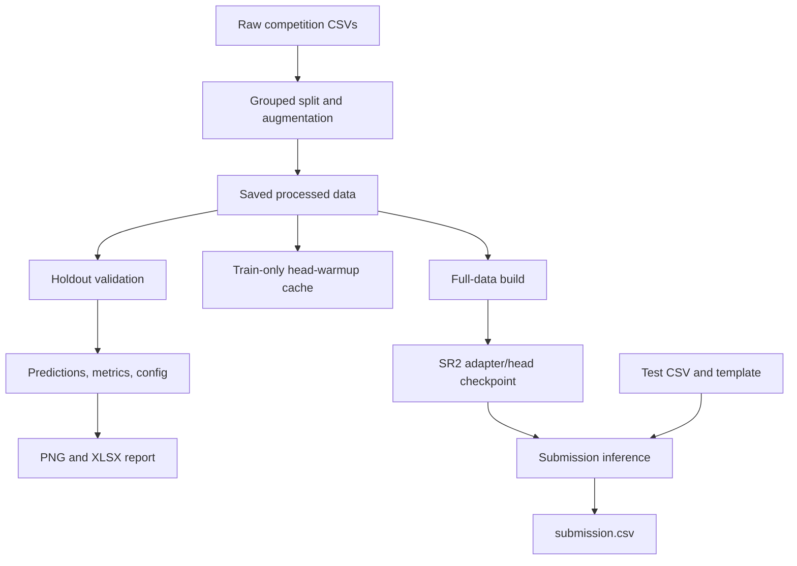

# Codebase reference

Use this map to find ownership before changing implementation. Keep user
interaction in CLI modules, orchestration in pipelines, and domain behavior in
focused classes. Prefer package public exports to private cross-package helpers.

## Documentation boundaries

| Document | Owns |
| --- | --- |
| [README.md](README.md) | Overview, active profiles, and navigation |
| [docs/getting-started.md](docs/getting-started.md), [docs/colab.md](docs/colab.md) | Local/remote setup and operational workflows |
| [docs/commands.md](docs/commands.md), [docs/configuration.md](docs/configuration.md) | CLI behavior, field definitions, defaults, path rules, and batch experiments |
| [docs/data-preparation.md](docs/data-preparation.md), [docs/models.md](docs/models.md), [docs/lora.md](docs/lora.md) | Data/model behavior and training algorithms |
| [docs/caching.md](docs/caching.md), [docs/reports.md](docs/reports.md) | Cache identities/APIs, artifacts, reporting, and measurements |
| [docs/troubleshooting.md](docs/troubleshooting.md), [docs/migration.md](docs/migration.md) | Failure diagnosis and historical formats |
| This file | Runtime flow, module responsibilities, artifact map, and implementation invariants |

Keep detailed behavior in its owning guide and link to it here. Preset parameter
values belong in YAML; parser defaults belong in the configuration reference.
Update this map when ownership or runtime flow changes. Preserve historical run
snapshots when updating current documentation or presets.

## Runtime flow

The saved split included in Git can enter this flow without downloading raw data.
Standalone warmup is optional; inline LoRA runs create/reuse their compatible
warmup state. Validation does not save production checkpoints. Builds use IDs
from both partitions; submission requires the matching checkpoint and test files.

Paths and `.env` resolve from the process working directory. The batch script
instead derives the project root from its own file and launches children there.
See [path resolution](docs/configuration.md#configuration-files-and-paths).

## Entry points

Console scripts are declared in [pyproject.toml](pyproject.toml).

| Command | Module under `src/llm_classification_finetuning/` | Responsibility |
| --- | --- | --- |
| `init` | `cli.py` | Download missing raw files, then preprocess |
| `data` | `data/cli.py` | Download only |
| `preprocess` | `preprocess/cli.py` | Rebuild the processed holdout |
| `model` | `models/cli.py` | Parse selection/mode, run profiles, monitor validation peaks, and print summaries |
| `result` | `result/cli.py` | Select a validation run and synthesize reports |

CLI modules translate expected `DataPreparationError` subclasses to exit status
`1`; parser errors retain argparse behavior. `models/cli.py` owns `ALL` iteration
and the build-only `warmup` selector outside the registry. Unsupported warmup
flags are rejected before data/GPU setup. Business logic stays below this layer.

[scripts/validate.py](scripts/validate.py) is the batch runner: explicit model/config
selection, sequential subprocesses, terminal/log streaming, and failure summary.
Its usage belongs in [commands](docs/commands.md#batch-validation).

## Package map

Paths below are relative to `src/llm_classification_finetuning/`.
Package `__init__.py` files expose intended public interfaces unless noted.

### Application and data preparation

| Module | Owns |
| --- | --- |
| `__init__.py` | Working-directory `.env` loading before library imports; PyTorch allocator and HF endpoint/Xet defaults without overriding explicit environment settings |
| `config.py` | Immutable config objects, strict YAML validation, data/cache path resolution, and effective shared warmup settings |
| `model_storage.py` | Native Hub cache routing through `load_pretrained`; timed backbone loading and restoration of progress-bar settings |
| `cli_config.py` | Shared `--config` argument |
| `cli_output.py` | Shared download/split summaries |
| `errors.py` | Expected domain-error hierarchy |
| `timing.py` | Unbounded `HH:MM:SS` duration formatting |
| `pipeline.py` | `PrepareDataPipeline`: download/preprocessing orchestration and optional download-progress callback |
| `data/downloader.py` | Missing Kaggle CSV downloads and single-file ZIP normalization |
| `preprocess/splits.py` | Labels/prompt hashes, grouped class quotas, balance orchestration, integrity summaries, and processed publication |
| `preprocess/token_balance.py` | Canonical token counting and deterministic equal-class whole-group exchanges |
| `preprocess/augmentation.py` | One swapped counterpart per original row |

### Profile registration and warmup

| Module | Owns |
| --- | --- |
| `models/__init__.py` | `ModelRegistration` and lazily loaded ordered active execution registry, keeping CPU data imports independent of PEFT |
| `models/profile.py` | Immutable selector/config/artifact identity and effective A/B policy |
| `models/SR2_Qwen3_4B_lora/__init__.py` | Active SR2 registration surface and public LoRA exports, deferring pipeline/trainer imports until execution |
| `models/SR2_Qwen3_4B_lora/profile.py` | SR2 identity usable below the registration surface without import cycles; default for LoRA Python APIs |
| `models/warmup.py` | Train-partition-only standalone SR2 head warmup, sharing SR2's cache namespace without adapters, validation, joint plans, or production checkpoint |

SR2 is the only registered model. `ALL` runs it when its YAML section is present;
`warmup` stays outside the registry. Retired profiles remain unregistered and
their configuration sections are rejected; local ignored
archives are outside active imports. See [migration](docs/migration.md#retired-profiles).

### Shared and frozen-model infrastructure

Paths in this table are under `models/common/`.
Frozen-model modules remain as retained infrastructure and shared dependencies;
they do not expose an active frozen CLI profile.

| Module | Owns |
| --- | --- |
| `contracts.py` | Execution modes, pipeline interface, and validation/build/submit/warmup result summaries |
| `inputs.py` | Processed/test table loading, strict split/orientation/ID validation, multipart reads, and reconstructed source fingerprints |
| `data.py` | Tokenizer-injected official chat-template serialization and pairwise training/test repositories |
| `hardware.py` | CUDA/precision validation, direct loading maps, dual-GPU layer placement, and per-run allocator peaks |
| `attention.py` | Scoped submission K/V-head expansion and fused-SDPA compatibility; restore predicates/backend flags |
| `backbone.py` | Local weight/configuration content fingerprints for caches |
| `compatibility.py` | Frozen embedding and head-checkpoint compatibility construction |
| `cache_storage.py` | Locked file sessions, atomic/multipart publication, checksums, and corruption archives |
| `token_cache.py` | Content-addressed text encodings, compact CPU views, canonical pair tokens, and context validation |
| `cache.py` | Per-branch SQLite frozen embeddings and rebinding to current rows |
| `extraction_batching.py` | Deterministic branch extraction plans comparing contiguous DP with best-fit by batch count, then padded tokens; stable length/iteration behavior |
| `extractor.py` | CPU identity preparation and lazy GPU encoding of missing frozen branches |
| `model.py` | Frozen backbone, last-real-token pooling, and `3H` pairwise MLP |
| `orientation.py` | A/B probability averaging and validation-row alignment |
| `loss.py` | Label smoothing on logits or averaged log probabilities; training reductions |
| `trainer.py` | Holdout/full-data frozen-head training and epoch metrics |
| `predictor.py` | Saved-head submission inference |
| `checkpoint.py` | Atomic frozen head persistence and compatibility validation |
| `progress.py` | CPU weighted-work counters and five-percent progress logs |
| `publishers.py` | Staged validation/submission publication, effective YAML snapshots, and successful-run timing/peak updates |
| `pipeline.py` | Frozen validation/build/submit orchestration |

### SR2 LoRA implementation

Paths in this table are under `models/SR2_Qwen3_4B_lora/`. SR2 owns the
implementation previously hosted by the retired EXPT2 profile; Python APIs
default to SR2. Retained legacy quantization/head branches are not active profiles.

| Module | Owns |
| --- | --- |
| `data.py` | Canonical token/feature views, branch flattening, independent right padding, and CPU pooling positions |
| `batching.py` | CPU loader preparation, shared tokens, global base plans, merged optimizer groups, epoch repacking, and warmup identity context |
| `heads.py` | Head factory, precision wrapper, swap-equivariant harmonic/discrepancy architecture, and retained legacy head definitions |
| `model.py` | Differentiable shared backbone/adapters, direct device loading, pooling/dtypes, head calls, and per-joint-batch checkpointing |
| `extractor.py` | Temporary no-gradient features for warmup, joint validation, or submission |
| `trainer.py` | CPU submission-token preparation, fixed-rate warmup and shared cosine-decayed joint learning rate, both branch graphs and one backward pass, optimizer/scaler state, validation/inference, shared progress, and standalone warmup cache short-circuit |
| `warmup_cache.py` | Completed head/AdamW/scaler/RNG identity, validation, atomic storage, and restoration |
| `checkpoint.py` | Portable adapter/head persistence, revision retention, and architecture/input compatibility |
| `pipeline.py` | LoRA holdout/build/submission orchestration and cleanup; non-quantized dual-GPU submission |

### Reporting

| Module | Owns |
| --- | --- |
| `result/synthesizer.py` | Discovery, holdout CSV validation, A/B alignment, aggregation-marker reduction, and source-ID records |
| `result/writers.py` | Confusion-matrix PNG and filterable Excel workbook |
| `result/publisher.py` | Staging/promotion of both reports with backup/restore handling |

## Files and generated artifacts

Default paths assume the root preset and working directory.

| Path | Role |
| --- | --- |
| `config.yaml`, `configs/*.yaml` | Independent complete current presets |
| `config_archive/` | Historical configurations; not current defaults |
| `.env.example` | Kaggle token and model/training-cache path template |
| `pyproject.toml`, `uv.lock`, `.python-version` | Package/entry points, training dependencies, and Python version |
| `requirements-submit.txt` | Separate submission installation pins |
| `<MODEL_PATH>/models--*/` | Native HF downloads; outside training-cache multipart storage |
| `data/raw/` | Downloaded raw CSVs |
| `data/processed/train_validation.parquet` | Logical saved split; single file or manifest plus volumes |
| `<CACHE_PATH>/token_cache/`, `embedding_cache/`, `adapter_batches/plans/` | Shared token, frozen-feature, and LoRA base-plan stores |
| `<CACHE_PATH>/SR2_Qwen3_4B_lora_warmup/` | Skywork completed warmup, shared by SR2 and standalone warmup |
| `models/SR2_Qwen3_4B_lora/adapter[_TAG].pt` | SR2 production adapter/head |
| `results/MODEL-<timestamp>/` | Completed validation CSV, metrics, and YAML snapshot |
| `results/submit/MODEL-<timestamp>/` | Submission CSV |
| `results/comprehensive/` | Latest synthesized report pair |
| `results/logs/validate-*.log` | Immediately flushed batch-run logs, including failures |

Runtime artifact directories are not source modules. The saved default split
and selected shared caches are tracked with regular Git storage; raw data,
working files, local notebooks, and local retired-code archives are ignored.
Historical Qwen checkpoints, results, configs, and warmup caches remain at their
original locations. Local `models/archive/qwen3_4b/` and
`models/archive/qwen3_4b_lora_EXPT2/` under the source package retain original
code/config/docs snapshots and retirement notes; they are reference material,
not independently runnable packages. Historical artifacts may coexist with current ones. Application logic must not
depend on a particular timestamped run or assume every artifact directory is
present in a fresh checkout.

## Invariants to preserve

1. **Split integrity:** all models share one saved grouped holdout. Group exchanges
   preserve canonical class/row counts, A/B counterparts stay together, and
   infeasible preparation leaves the previous dataset intact. See
   [data preparation](docs/data-preparation.md).
2. **Input and output order:** validate complete processed orientation pairs and
   test/template ID order before execution. Render alternating user/assistant
   turns with the tokenizer's official chat template, no system message, and no
   generation prompt; preserve its default reasoning block and trailing newline.
   Encode with the same tokenizer and `add_special_tokens=False`. Predictions
   use the fixed competition column order with finite
   normalized probabilities. See [inputs](docs/models.md#build-and-submit).
3. **Profile objectives:** SR2 uses shared cross projections with harmonic fusion
   and a discrepancy correction, on original rows only. Derive both symmetric
   features before dropout; share one win mask and use independent fusion and
   discrepancy masks. Compute the correction once for the tie branch. Architecture
   `swap_equivariant_harmonic_discrepancy_v2` uses six Xavier-uniform matrices
   (gain 1.0), zero-initialized hidden biases, and one zero-initialized FP32 scalar
   tie bias. Harmonic fusion (epsilon `1e-8`) and final logit arithmetic stay FP32.
   Batch A/B projections and the shared win readout; wins have no `q` term and
   tie uses `s - q + b`. V2 removes the v1 factor of two without changing the
   parameter layout; its architecture marker isolates v1 state.
   Its marker and exact parameter structure isolate warmup caches and reject
   earlier tie-from-wins production checkpoints.
   See [head definition](docs/lora.md#swap-equivariant-head).
4. **Cache identities:** distinguish tokens, frozen embeddings, plans, warmup,
   and production checkpoints. Map cached entries to current rows/labels; never
   infer one compatibility from another. Version identities when their actual
   representation/algorithm changes. See [caching](docs/caching.md).
5. **CPU preparation:** token/loader/plan preparation must not load model weights
   or initialize CUDA. Complete frozen/warmup hits skip backbone weights while
   retaining applicable input and hardware checks.
6. **LoRA inputs and attention:** never truncate adapter inputs. Right-pad without
   masks, pool the last real token, and preserve scoped SDPA/checkpoint
   recomputation settings. Restore global predicates/flags after failures.
   See [hardware/input behavior](docs/lora.md#hardware-and-input-limits).
7. **Optimizer groups:** preserve row-normalized loss, one clipping/update boundary
   per finalized group, short-tail merging, and the merged joint update last.
   Epoch length queries must match iteration without changing RNG state.
   Packing and checkpointing use total independently padded A/B tokens
   (`rows * (longest_A + longest_B)`). Both passes compare optimal contiguous
   DP cuts with best-fit, minimizing micro-batch count before total padded
   tokens and retaining best-fit on exact ties. DP preserves each global sort
   in the initial pass and descending A+B order in the second; individually
   oversized rows stay alone outside the eligible sequence. Best-fit placements
   minimize remaining budget, then creation order.
   Planning, plan validation, and runtime share this cost definition. Both
   packing passes stay within finalized update boundaries.
   Checkpointing is chosen once per A/B joint micro-batch through backward;
   both branch graphs are retained until one backward pass, and disabling
   checkpointing removes input-gradient hooks. Joint groups share one learning
   rate and one cosine curve across all joint epochs; each consumed optimizer
   group advances decay once, including FP16-skipped updates. Warmup stays at a
   fixed rate. See
   [batching](docs/lora.md#optional-token-budget-training-batches).
8. **Precision:** trainable adapter/head parameters, gradients, and AdamW moments
   stay FP32. BF16 features/head autocast and FP32 logits retain the documented
   policy; submission disables gradient checkpointing. See [precision](docs/lora.md#hardware-and-input-limits).
9. **Warmup state:** publish only completed compatible head/optimizer/scaler/RNG
   states, validate them before restoration, and retain current training-ID
   semantics. No persisted live LoRA features. See [warmup](docs/caching.md#lora-head-warmup).
10. **Placement and production state:** load backbones directly with device maps;
    submission uses exactly two GPUs without replicas/offload/fallback. Production
    builds omit base weights and optimizer state; LoRA retains its Hub revision.
    See [GPU layout](docs/configuration.md#gpu-configuration) and [checkpoints](docs/lora.md#checkpoints).
11. **Publication:** stage generated artifacts before exposure. `CacheStorage`
    owns locks/checksums/multipart policy; report promotion restores previous
    output where recoverable. Preserve explicit failures and backup paths.
12. **Metrics and history:** publish final-epoch holdout predictions and matching
    current-only YAML sections; never rewrite historical snapshots. Successful
    complete-run timing/peaks are appended atomically. Progress remains CPU-only
    and covers executed weighted work, not extraction/publication. See
    [reports](docs/reports.md) and [progress](docs/models.md#training-progress).

## Documentation maintenance

When changing behavior, update its owning guide and this map only where
responsibilities or invariants changed. Check examples against CLI parsers and
`AppConfig`, keep local links/anchors valid, and use YAML as the authority for
preset values. Follow [AGENTS.md](AGENTS.md), including `ruff format` for each
Python file edited; documentation-only changes do not require running training.
